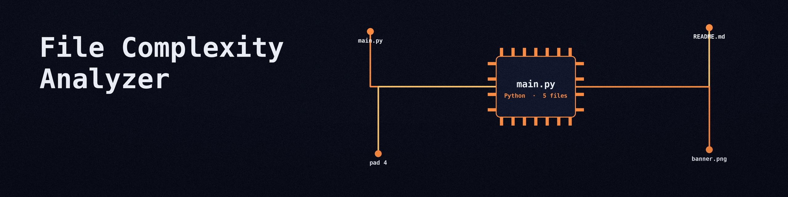

# file-complexity-analyzer
Analyzes a binary file and reports one verified metric: code density, the percentage of non-zero bytes in the file. Control flow and data dependency analysis are not performed by this tool, and no such results are printed or filed in the report. An empty file exits 1 with a plain line and is never a completed analysis. An `--output` path that resolves to the input file is refused at exit 1. A report that cannot be written ends the run at exit 1. - Focused on File operations and analysis

## Install
`git clone https://github.com/ShadowStrikeHQ/file-complexity-analyzer`

## Usage
`./file-complexity-analyzer [params]`

## Parameters
- `-h`: Show help message and exit
- `--output`: No description provided
- `--debug`: Enable debug logging.

## License
Copyright (c) ShadowStrikeHQ
